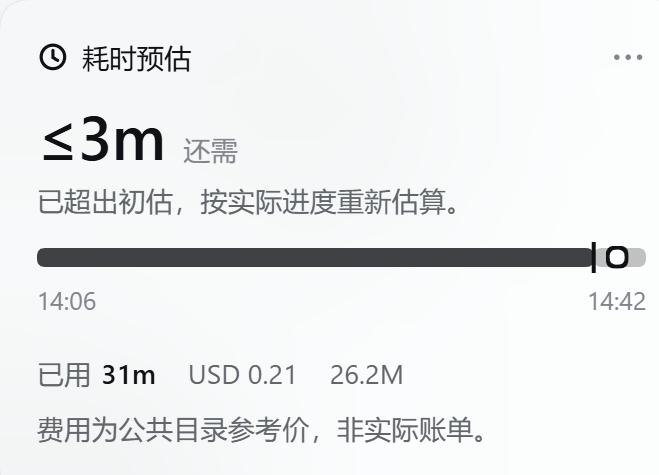

# DSH task time and cost estimator

**A reference for the wait.** See remaining time, actual duration and cost references beside native Token statistics in DeepSeek Harness, calibrated to local routes; the model-based estimate is on by default and reuses the session route.

[中文](README.md) · [Download stable](https://github.com/leicheng42/dsh-task-time-cost/releases/tag/v0.8.1) · [User guide](docs/public/guide.en.md) · [Report an issue](https://github.com/leicheng42/dsh-task-time-cost/issues/new/choose)

[](https://github.com/leicheng42/dsh-task-time-cost/releases) [](https://github.com/leicheng42/dsh-task-time-cost/actions/workflows/ci.yml) [](LICENSE)



*Actual panel on DSH Desktop 0.2.2-rc.2, cropped to the plugin's own surface. The top answers "how much longer and by when"; the gauge shows the full range; the table compares time, Tokens and cost through the same spent / left / forecast-total columns. Values belong to the capture-time task and prices are public references.*

## What it does

Version 0.8.1 provides these features:

- **See the wait at a glance:** the panel leads with one central figure, a gauge for the full range with its bounds, then small cards for everything else.
- **Only show what is useful:** unknown values no longer take a row, repeated ranges are merged, and the explanation is a single line; full evidence and exact amounts live under More → details.
- **A timeline plus three progress bars:** the top is a real timeline from task start to the predicted finish, marking where "now" sits and how wide the uncertainty is; time, Tokens and cost each get a spent-vs-left bar, and an unknown remainder is drawn dashed instead of pretending to be 0%.
- **A completion clock:** both the entry line and the panel say "done by HH:MM", keeping the date when it crosses midnight.
- **Range first:** a single "about X" appears only in the stable state; earlier states show a range and an early/calibrating tag, so a long task cannot open with a confident-looking two minutes.
- **Estimate trail:** the panel plots how the remaining estimate moved during the turn.
- **A wrong forecast is corrected, not repeated:** once a turn outlives its own first estimate, or a self-reported plan claims a small fraction of the time already spent, the panel switches to 已校正, stops printing a finish time in the past and re-estimates from observed work ([design](docs/public/design.md)).
- **The model estimate is only for long tasks:** a task forecast to finish within about five minutes never sends that request; a long or still-unknown one gets one bounded estimate through the current session route. The switch sits at the top of the panel, one click, no provider to configure (an optional override exists).
- **Optional estimator override:** when enabled, and the executing agent has not planned within the wait window, one bounded estimate is requested from the provider/model you name (off by default, with an explicit notice that the task text is sent to that model).
- **Plan before numbers:** while a task has neither an executing-agent plan nor a local sample, the panel says it is still assessing instead of printing a prior; a submitted `task_estimate_plan` switches it to a planned estimate.
- **Version and platform compatibility:** admit the current 0.2.x API line, including rc.3; 0.3+ awaits a new contract review. Dark theme, narrow windows and keyboard use follow the Host's own design tokens.
- **Start with the project scope:** read ordinary requests and real Goal objectives; complete multi-app systems receive a project-scale initial reference, then a full-objective model plan can revise it.
- **Estimate the wait:** show a central time and the complete reference interval; sufficient comparable local tasks update the workload budget using their observed distribution.
- **See forecast Tokens:** observed Tokens, estimated remaining output and available total forecasts are separate. Less-used details and settings live under the header’s More (⋯) button.
- **Explain cost coverage:** known-model public list-price references with explicit overrides, without treating missing prices as free.
- **Learn locally:** route latency/speed, sources, samples and dates, plus JSON/CSV baselines and local statistics export.
- **Keep useful references:** retain the last valid time reference with its date when current planning is insufficient; bounded plans from the executing AI help estimate remaining work.

## Install

In DSH **Plugin Manager → Add plugin**, enter `dsh-task-time-cost@0.8.1` for the stable release. Both channels supply prebuilt files with no installation scripts.

```sh
dsh plugin --profile desktop add dsh-task-time-cost@0.8.1
```

Alternatively, install the pinned GitHub Release archive:

1. In DSH **Plugin Manager → Add plugin**, paste the archive URL below, or download it and select the local archive.
2. Enable **Task time and cost estimator** and restart when the Host asks.
3. Open the **clock beside Token statistics** for forecast Tokens. **More (⋯) → Settings and calibration** shows route samples.

```text
https://github.com/leicheng42/dsh-task-time-cost/releases/download/v0.8.1/dsh-task-time-cost-0.8.1.tgz
```

CLI (replace desktop with your profile):

```sh
dsh plugin --profile desktop add https://github.com/leicheng42/dsh-task-time-cost/releases/download/v0.8.1/dsh-task-time-cost-0.8.1.tgz
```

## Supported scope

**0.3.2: DSH `>=0.2.2-rc.1 <0.3.0-0` / Node 24+; Windows, macOS and Linux Hosts.** The CI matrix covers rc.1/rc.2/rc.3 on all three operating systems with one prebuilt archive. Windows Desktop has actual UI acceptance; native macOS/Linux pixel and window-drag acceptance remains unverified. See [compatibility](COMPATIBILITY.md) and [acceptance scope](docs/public/acceptance.md).

Time ranges are references, not promises or confidence intervals. Startup values are engineering priors. The release report separates chronological replay from actual process overhead. Online full-Goal error distributions and controlled provider comparisons are not established. Exact native running-line placement has no verified public seat; the entry is beside Tokens.

Prices are versioned list-price references or user rates, not subscription/relay invoices. Ambiguous reasoning/cache usage or incomplete future budgets stay unknown; currencies remain separate. Original price resolutions and initial forecasts are retained.

## Privacy and trust

No prompts, code bodies, tool arguments or credentials are saved by default. No statistics uploads or background price refresh. The **estimator model is on by default** and reuses the provider/model route this session already uses, so no new recipient receives the text; the task text is never stored locally, and the switch turns it off in one click. Exports include configuration and route/session identities; review before sharing. [Privacy](docs/public/privacy.md)

Releases include SHA-256 and verification summaries. Follow Host restart requirements after updates. Keep diagnostics for repeated load failures instead of repeatedly reloading.

## Help improve it

[Report](https://github.com/leicheng42/dsh-task-time-cost/issues/new/choose) versions, steps and sanitized logs. Do not upload raw sessions or complete statistics exports. [Contributing](CONTRIBUTING.md)

An unofficial community plugin, not affiliated with DeepSeek. Public list-price references come from [models.dev](https://models.dev/). [Changes](CHANGELOG.md) · [MIT](LICENSE)
