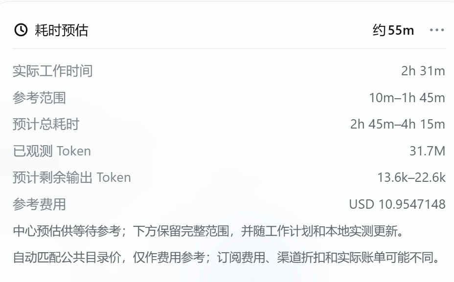
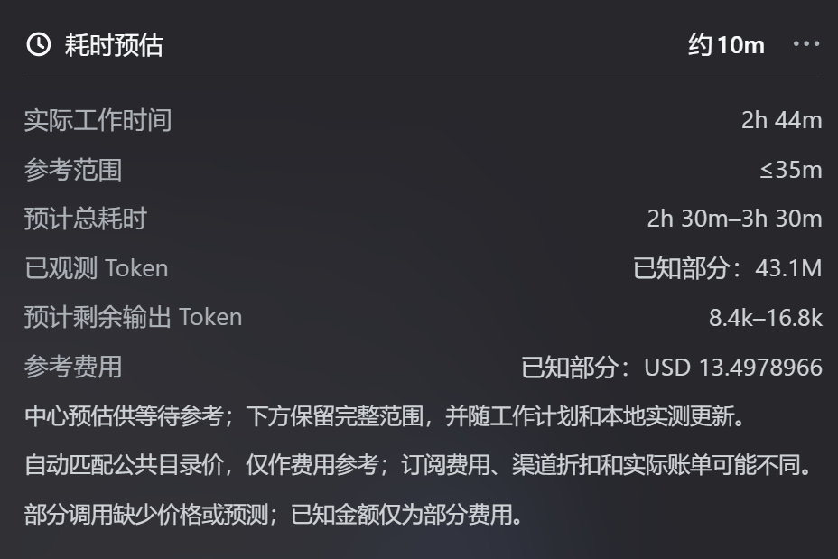

# DSH task time and cost estimator

**A reference for the wait.** See remaining time, actual duration and cost references beside native Token statistics in DeepSeek Harness, calibrated to local routes without a separate estimator-model call.

[中文](README.md) · [Download preview](https://github.com/leicheng42/dsh-task-time-cost/releases/tag/v0.2.9-beta.1) · [User guide](docs/public/guide.en.md) · [Report an issue](https://github.com/leicheng42/dsh-task-time-cost/issues/new/choose)

[](https://github.com/leicheng42/dsh-task-time-cost/releases) [](https://github.com/leicheng42/dsh-task-time-cost/actions/workflows/ci.yml) [](LICENSE)



<details><summary>Dark theme</summary>



</details>

*Real runtime capture: Windows / DSH Desktop 0.2.2-rc.2 / the0.3.0 candidate under verification. The downloadable preview is0.2.9-beta.1. Values belong to the task at capture time; prices are public-catalog references.*

## What it does

These improvements describe the current 0.3.0 candidate source; the downloadable version remains the preview identified above.

- **Start with the project scope:** read ordinary requests and real Goal objectives; complete multi-app systems receive a project-scale initial reference, then a full-objective model plan can revise it.
- **Estimate the wait:** show a central time and the complete reference interval; sufficient comparable local tasks update the workload budget using their observed distribution.
- **See forecast Tokens:** observed Tokens, estimated remaining output and available total forecasts are separate. Less-used details and settings live under the header’s More (⋯) button.
- **Explain cost coverage:** known-model public list-price references with explicit overrides, without treating missing prices as free.
- **Learn locally:** route latency/speed, sources, samples and dates, plus JSON/CSV baselines and local statistics export.
- **Keep useful references:** retain the last valid time reference with its date when current planning is insufficient; bounded plans from the executing AI help estimate remaining work.

## Install

In DSH **Plugin Manager → Add plugin**, enter `dsh-task-time-cost@beta` for the preview. Both channels supply prebuilt files with no installation scripts.

```sh
dsh plugin --profile desktop add dsh-task-time-cost@beta
```

Alternatively, install the pinned GitHub Release archive:

1. In DSH **Plugin Manager → Add plugin**, paste the archive URL below, or download it and select the local archive.
2. Enable **Task time and cost estimator** and restart when the Host asks.
3. Open the **clock beside Token statistics** for forecast Tokens. **More (⋯) → Settings and calibration** shows route samples.

```text
https://github.com/leicheng42/dsh-task-time-cost/releases/download/v0.2.9-beta.1/dsh-task-time-cost-0.2.9-beta.1.tgz
```

CLI (replace desktop with your profile):

```sh
dsh plugin --profile desktop add https://github.com/leicheng42/dsh-task-time-cost/releases/download/v0.2.9-beta.1/dsh-task-time-cost-0.2.9-beta.1.tgz
```

## Preview scope

**0.2.9-beta.1: Windows / DSH Desktop 0.2.2-rc.2 / Node24+.** Other environments remain unverified. [Compatibility](COMPATIBILITY.md) and [acceptance](docs/public/acceptance.md) retain open gates.

Time ranges are references, not promises or confidence intervals. Startup values are engineering priors. Full online-task accuracy, controlled provider comparisons and observer overhead remain unmeasured. Exact native running-line placement has no verified public seat; the entry is beside Tokens.

Prices are versioned list-price references or user rates, not subscription/relay invoices. Ambiguous reasoning/cache usage or incomplete future budgets stay unknown; currencies remain separate. Original price resolutions and initial forecasts are retained.

## Privacy and trust

No prompts, code bodies, tool arguments or credentials are saved by default. No statistics uploads, background price refresh or separate estimator call. Exports include configuration and route/session identities; review before sharing. [Privacy](docs/public/privacy.md)

Releases include SHA-256 and verification summaries. Follow Host restart requirements after updates. Keep diagnostics for repeated load failures instead of repeatedly reloading.

## Help improve it

[Report](https://github.com/leicheng42/dsh-task-time-cost/issues/new/choose) versions, steps and sanitized logs. Do not upload raw sessions or complete statistics exports. [Contributing](CONTRIBUTING.md)

An unofficial community plugin, not affiliated with DeepSeek. Public list-price references come from [models.dev](https://models.dev/). [Changes](CHANGELOG.md) · [MIT](LICENSE)
